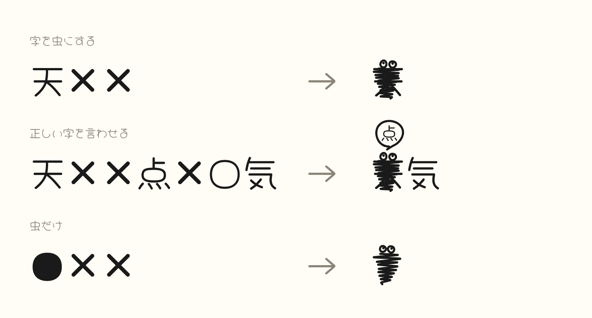
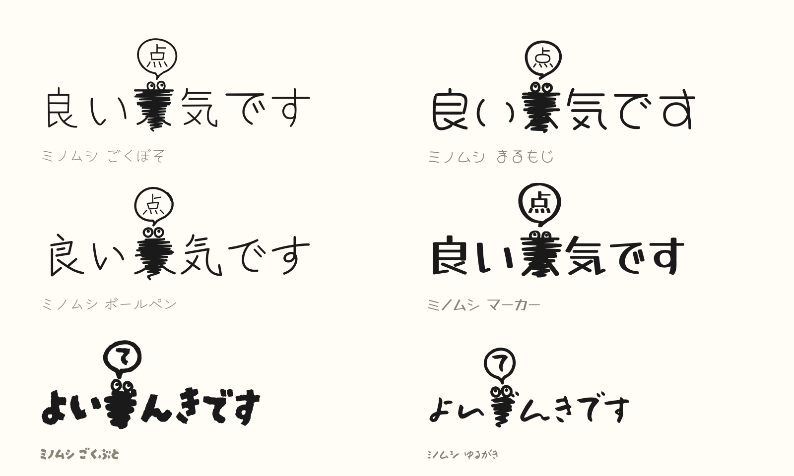
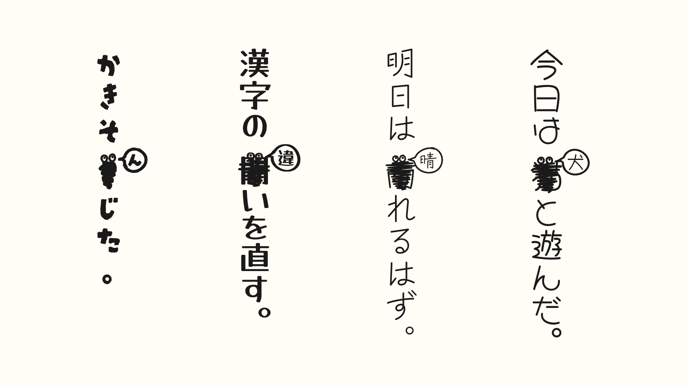
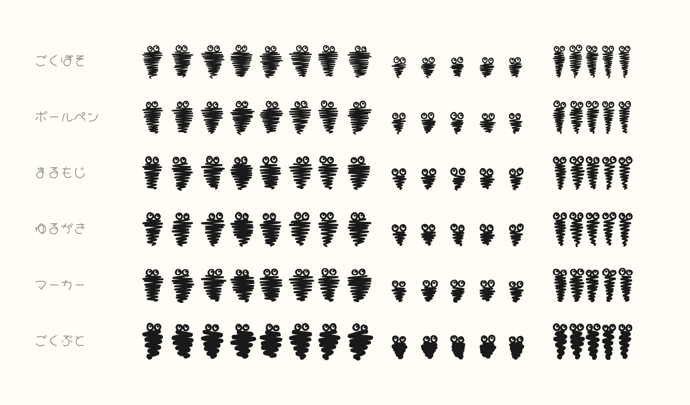

# ミノムシフォント

書き損じた字を黒く塗りつぶして目を描き、正しい字を吹き出しで言わせる「書き損じミノムシ」を、文字を打つだけで出せるフォントです。



バージョン 1.000

## ダウンロード

- 6書体（漢字やかなを含むフォント）は、このリポジトリの Releases にあります。
- 虫だけの軽いフォント「ミノムシ のみ」は、[dist-solo/](dist-solo/) にあります。

## 書体



| 書体 | ファイル | 元のフォント | 漢字 |
|---|---|---|---|
| ミノムシ ごくぼそ | MinomushiGokuboso-Regular.ttf | Yomogi | あり |
| ミノムシ まるもじ | MinomushiMarumoji-Regular.ttf | Hachi Maru Pop | あり |
| ミノムシ ボールペン | MinomushiBallpen-Regular.ttf | Zen Kurenaido | あり |
| ミノムシ マーカー | MinomushiMarker-Regular.ttf | Yusei Magic | あり |
| ミノムシ ごくぶと | MinomushiGokubuto-Regular.ttf | Darumadrop One | なし（かな・英数字・記号） |
| ミノムシ ゆるがき | MinomushiYurugaki-Regular.ttf | Slackside One | なし（かな・英数字・記号） |

元のフォントの字と機能は、すべてそのまま残してあります。

## 使い方は2通り

### 1. 記号を打つ（合字）

字のあとに記号を打つと、虫や吹き出しに変わります。どのアプリでも、文字を打つだけで使えます。

| 打ち方 | 出るもの |
|---|---|
| 字✕✕ | その字を虫で塗りつぶす |
| 字✕○ | その字を吹き出しにして、直前の字の上（縦書きは右）に出す |
| ●✕✕ | 虫だけ（下に字がない） |

例:「天✕✕点✕○気」と打つと、「天」が虫になり、その上に「点」の吹き出しが出て、「気」が続きます。

- ✕ は U+2715 です。「ばつ」の変換候補にあります。掛け算の ×（U+00D7）やアルファベットの X では変わりません。
- ○ は U+25CB、● は U+25CF です。「まる」で変換できます。
- ✕ を使わない × ○ ● は、元の記号のまま出ます。

### 2. スタイルセットを指定する

テキストは元の字のまま、見た目だけを変えます。コピーや読み上げに記号が混ざりません。

| 指定 | 出るもの |
|---|---|
| ss01 | 字を虫で塗りつぶす |
| ss02 | 虫と、その字の吹き出し（字を消して同じ字を言わせる。飾り向き） |
| ss03 | 吹き出しだけ。直前の字の上に出す |

別の字に直すには、書き損じの字に ss01、正しい字に ss03 を指定します。ss03 は1字ずつ使います。2字以上続けると、吹き出しが重なります。

- Web: `font-feature-settings: "ss01";`
- Illustrator: OpenType パネルのメニュー →「スタイルセット」

### どちらを使うか

| 場面 | 勧める方法 |
|---|---|
| 横書きで、同じ字を虫にするだけ | ss01 か ss02 |
| 横書きで、別の字に直す | 合字、または ss01 + ss03 |
| 縦書きで、別の字に直す | 合字（ss01 + ss03 は吹き出しが1字分下にずれます） |
| 縦書きの漢字 | 合字（下の「制約」を見てください） |

## 行間

吹き出しは行の上へ大きくはみ出します。行間を広げて使ってください。目安は、横書きで文字サイズの 2.3 倍以上、縦書きで 2.5 倍以上です。

縦書きでは、吹き出しが虫の右に出ます。



## Web で使う

Chrome 系はそのまま出ます。Safari と Firefox には、次の指定が要ります。3つのブラウザで同時に使えます。

```css
@font-face {
  font-family: "Minomushi Gokuboso";
  src: url("MinomushiGokuboso-Regular.ttf");
}
.mino-text {
  font-family: "Minomushi Gokuboso";
  line-height: 2.5;
}
/* Firefox: 縦書きの吹き出しが途中で切れるのを防ぐ */
.mino-tate {
  writing-mode: vertical-rl;
  text-shadow: 1em 0 0 transparent;
}
/* Safari: 合字のあとの要素がずれる・行の折り返しで合字が割れるのを防ぐ */
.mino {
  word-break: keep-all;
}
```

```html
<!-- 横書き -->
<p class="mino-text">今日は良い<span class="mino">天✕✕点✕○</span>気です。</p>

<!-- 縦書き: span に、となりのかなか句読点を1字入れる -->
<p class="mino-text mino-tate">今日は<span class="mino">猫✕✕犬✕○と</span>遊んだ。</p>
```

- `.mino` の span は、合字のときだけ要ります。スタイルセットには要りません。
- 縦書きでは、span を使わずに地の文へそのまま書いても出ます。

### Safari の縦書きの制約

Safari は縦書きで、**漢字と記号だけの要素**を正しく組みません。虫と吹き出しが横書きの形で出て、次の字に重なります。同じ要素の中に、かな・句読点・全角の字が1字でもあれば正しく出ます。

| 書き方 | Safari の縦書き |
|---|---|
| `猫✕✕犬✕○だ`（span なし） | 出る |
| `<span>猫✕✕犬✕○だ</span>` | 出る |
| `<span>猫✕✕犬✕○</span>だ` | 崩れる |
| `<span class="ss02">東</span>だ` | 崩れる |
| `<span class="ss02">え</span>だ`（かな） | 出る |

このため、Safari の縦書きでは、漢字1字だけに ss02 をかける使い方ができません。漢字は合字で書いてください。ss01（虫だけ）は、漢字1字でも出ます。

半角の英数字は、Safari の縦書きでは虫になりません。全角を使ってください。

## Illustrator で使う

- 合字は、横書き・縦書きとも出ます。
- スタイルセットは、横書きではすべて出ます。縦書きでは、漢字の ss02 だけ出ません（かなの ss02 は出ます）。縦書きの漢字は合字で書いてください。
- ss01 + ss03 で別の字に直す書き方は、横書き・縦書きとも出ます。縦書きでも、吹き出しは虫の右に付きます。
- フォントを入れ直したときは、Illustrator を再起動してください。

## 虫だけのフォント（ミノムシ のみ）

元のフォントの字を含まない、虫だけの軽いフォントです（1ファイル 29〜49 KB）。吹き出しはありません。好きな書体の文章の中で、虫にしたい1字だけをこのフォントにして使います。

バージョン 1.000。ファイルは `dist-solo/` にあります。



| ファイル | 太さ |
|---|---|
| MinomushiNomi-Gokuboso.ttf | ごくぼそ |
| MinomushiNomi-Ballpen.ttf | ボールペン |
| MinomushiNomi-Marumoji.ttf | まるもじ（標準） |
| MinomushiNomi-Yurugaki.ttf | ゆるがき |
| MinomushiNomi-Marker.ttf | マーカー |
| MinomushiNomi-Gokubuto.ttf | ごくぶと |

英数字を打つと虫が出ます。字ごとに形が違います。

| 打つ字 | 出るもの |
|---|---|
| A〜Z | ふつうの虫（全角幅）、26通り |
| a〜z | 小さい虫（全角幅の下寄せ。小書きのかな向け）、26通り |
| 0〜9 | 細い虫（半角幅）、10通り |

- 全角の英数字でも同じ虫が出ます。
- 縦書きでは全角で打ってください。半角は横倒しになります。Web では `text-orientation: upright` を指定すれば、半角でも立ちます。
- テキストには英数字が残ります。コピーや読み上げでは「A」などになります。
- Chromium・Safari・Firefox・Illustrator の横書きと縦書きで確認しました。回避用の指定は要りません。

## 確認した環境

| 環境 | 確認した内容 |
|---|---|
| Chromium（Claude デスクトップアプリ内） | 6書体。横書き・縦書き、合字・ss01〜03 |
| Safari（macOS） | 6書体。横書き・縦書き、合字・ss01〜03。上の制約あり |
| Firefox 160（macOS） | 6書体の合字と ss02。ss01・ss03 は未確認 |
| Google Chrome 156（macOS） | 6書体。横書き・縦書きの合字と ss02、横書きの ss01 + ss03 |
| Illustrator 2027（macOS） | 合字と ss01・ss02。6書体の ss01 + ss03（横書き・縦書き） |

Word、InDesign では確認していません。

## フォントを作り直す

元のフォント（`base/`）に虫と吹き出しを足して、6書体を作ります。

```bash
pip install fonttools
python3 build_font.py    # 6書体を dist/ に作る（20分ほどかかります）
python3 build_solo.py    # 「ミノムシ のみ」を dist-solo/ に作る
python3 make_images.py   # この説明書の画像を images/ に作る
```

- Python 3.9 と fontTools 4.58 で動かしています。
- `make_images.py` と `check_font.py` は、HarfBuzz の `hb-shape` も使います。`make_images.py` は macOS の `sips` で PNG にします。
- できた字形は `preview.html` で確かめられます。フォルダーをローカルのサーバーで開いてください（例: `python3 -m http.server`）。

| ファイル | 内容 |
|---|---|
| `build_font.py` | 6書体を作る |
| `build_solo.py` | 「ミノムシ のみ」を作る |
| `check_font.py` | できたフォントを検査する |
| `make_images.py` | 説明書とソーシャルプレビューの画像を作る |
| `make_eyecatch.py` | 記事用のアイキャッチを作る |
| `preview.html` | 見本ページ |
| `base/` | 元のフォントと、そのライセンス |

## ライセンス

フォントは、全書体とも SIL Open Font License 1.1 です。商用・非商用を問わず使えます。改変と再配布は、同じライセンスのもとで行えます。フォントファイル単体での販売はできません。

「ミノムシ のみ」の著作権表示:

- Copyright 2026 Pronama LLC

6書体の元のフォントの著作権表示:

- Yomogi: Copyright 2020 The Yomogi Project Authors (https://github.com/satsuyako/YomogiFont)
- Hachi Maru Pop: Copyright 2020 The Hachi Maru Pop Project Authors (https://github.com/noriokanisawa/HachiMaruPop)
- Zen Kurenaido: Copyright 2021 The Zen Kurenaido Project Authors (https://github.com/googlefonts/zen-kurenaido)
- Yusei Magic: Copyright 2020 The Yusei Magic Project Authors (https://github.com/tanukifont/YuseiMagic)
- Darumadrop One: Copyright 2020 The Darumadrop Project Authors (https://github.com/ManiackersDesign/darumadrop)
- Slackside One: Copyright 2020 The Slackside One Project Authors (https://github.com/ManiackersDesign/slackside)

ライセンスの全文は [OFL.txt](OFL.txt) にあります。元のフォントごとの文面は `base/` フォルダーの OFL-*.txt です。

スクリプト（`*.py`）と `preview.html` は MIT License です（[LICENSE-MIT.txt](LICENSE-MIT.txt)）。
